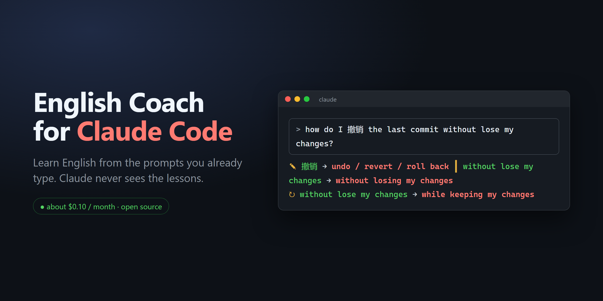
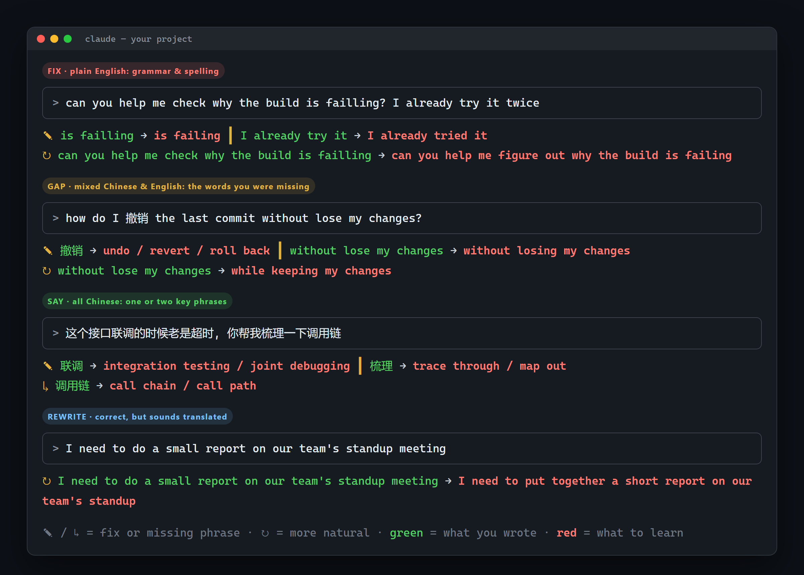
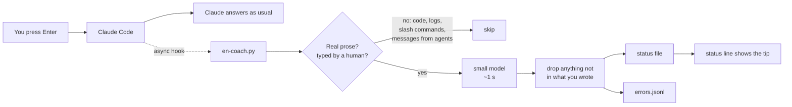

<p align="center">
  
</p>

<p align="center">
  <a href="https://github.com/Skyxu-001/en-coach/actions/workflows/test.yml"></a>
  
  
  
  <br>
  <b>English</b> · <a href="README.zh-CN.md">简体中文</a>
</p>

# en-coach

**Practise English with the prompts you already type to Claude Code. Claude never sees the lessons.**

You keep working as usual. Each message you send gets a quick look from a small,
cheap model, and a line or two of coaching appears under your prompt a second later:
the grammar you got wrong, the English for the Chinese words you couldn't think of,
or a more natural way to say what you just said.

<p align="center">
  
  <br><sub>Real model output from the hook; the terminal frame is simplified.</sub>
</p>

## Why I built it

I'm a software engineer whose first language is Chinese. I spend all day talking
to Claude Code, half in English and half in Chinese, and that was hours of
practice I wasn't learning anything from. Flashcard apps never stuck. So I put
the lessons where I already am, and kept them out of the way:

- **Zero extra effort.** No app, no commands, no flashcards. Just keep coding.
- **Mixed Chinese and English is fine.** Write `how do I 撤销 the last commit` and
  it teaches you `撤销 → undo / revert / roll back`. Writing in whatever comes
  out first is the point, not a compromise.
- **Claude is unaffected.** The hook prints nothing; tips go to the status line,
  which is not part of the conversation. Claude's answers are the same with or
  without it (checked by running the same prompts both ways).
- **Cheap.** About **$0.10 a month** at ~40 coached messages a day with DeepSeek.
  Any OpenAI-compatible API works.

## What it teaches

| | When | What you see |
|---|---|---|
| **FIX** | you wrote English | the error, quoted in context, and the fix: `is failling → is failing` |
| **GAP** | you mixed in Chinese | the English for the part you didn't know: `撤销 → undo / revert / roll back` |
| **SAY** | you wrote Chinese | just one or two phrases worth learning: `联调 → integration testing` |
| **REWRITE** ↻ | grammatical but sounds translated | how a native engineer would say it |

**Green** is what you wrote, **red** is what to learn. Everything is also saved to
`~/.claude/english/errors.jsonl`, your personal log of mistakes to review later.

## Install

You need Python 3.9+ and an API key for an OpenAI-compatible chat API
(DeepSeek by default).

```sh
git clone https://github.com/Skyxu-001/en-coach.git
cd en-coach
python3 install.py          # Windows: py install.py
```

Then give it your key, in your shell profile:

```sh
export DEEPSEEK_API_KEY=sk-...
```

or in the `env` block of `~/.claude/settings.json`:

```json
{ "env": { "DEEPSEEK_API_KEY": "sk-..." } }
```

Start a new Claude Code session and type something. The installer:

- copies two scripts to `~/.claude/english-coach/`
- adds one **async** `UserPromptSubmit` hook, so it never slows your prompt down
- sets the status line to show the tip; **if you already have a status line it is
  kept** and shown above the tip
- backs up `settings.json` first

`python3 install.py --dry-run` shows the change without making it.
`python3 install.py --uninstall` removes everything except your error log.

## Configuration

All optional, set as environment variables:

| Variable | Default | |
|---|---|---|
| `EN_COACH_API_KEY` / `DEEPSEEK_API_KEY` | | API key (the first one wins) |
| `EN_COACH_BASE_URL` | `https://api.deepseek.com` | any OpenAI-compatible endpoint, e.g. `https://api.openai.com/v1`, `https://openrouter.ai/api/v1`, or a local Ollama `http://localhost:11434/v1` |
| `EN_COACH_MODEL` | `deepseek-flash` | model name for that endpoint |
| `EN_COACH_LOG` | `1` | `0` to stop writing the error log |
| `EN_COACH_DATA_DIR` | `~/.claude/english` | where tips and the log live |

Pick a fast model. The tip is only useful if it shows up while you're still
looking at your prompt.

## How it works



A few things that took real debugging to get right, all covered by the 62 offline tests:

- **Only your words get coached.** Code, stack traces, logs, diffs, and command
  lines are stripped line by line. Messages that the harness injects (background
  task notices, other sessions, sub-agents) are removed too.
- **The model is not trusted.** Any correction whose quoted text isn't literally in
  your message is dropped, and so is a rewrite that only repeats a correction.
- **Nothing it prints can reach Claude.** The hook writes files, never stdout;
  a test runs the real script and checks that it prints nothing.
- **It works on Chinese Windows.** stdin is pinned to UTF-8. Without that, every
  Chinese prompt arrived as mojibake and nothing happened, with no error.

The full list of what broke and why is in [docs/lessons-learned.md](docs/lessons-learned.md),
including six ways I tried to make the model teach *more* that all failed.

## Optional: spell-check as you type

Claude Code's built-in `spellcheck` setting uses hunspell to underline typos in
the input box, locally and for free. [`spellcheck/`](spellcheck) has a small
dictionary of tech words (`yaml`, `kubectl`, `webhook`...) so they aren't flagged.
See [spellcheck/README.md](spellcheck/README.md).

## FAQ

**Will this change Claude's answers?**
No. The hook writes nothing to stdout, and the status line is not sent to the model.

**What gets sent to the API?**
Up to 400 characters of the prose in your message, after code and logs are removed.
Nothing else: not your files, not Claude's replies.

**I don't speak Chinese. Is it useful?**
FIX and REWRITE work for anyone writing English. GAP and SAY are tuned for Chinese
speakers. The prompt is in [`hooks/en-coach.py`](hooks/en-coach.py) if you want
to adapt it to your language.

**Is it slow?**
The hook runs in the background. The tip appears 1 to 6 seconds after you press
Enter: about a second for the model, plus up to 5 seconds for the status line to
refresh. Don't lower `refreshInterval` below 5; see the lessons doc for why.

## Tests

```sh
python3 -B tests/test_en_coach.py
```

Offline, no key needed. CI runs them on Linux, macOS, and Windows with Python 3.9 and 3.13.

## Acknowledgements

The async-hook-plus-status-line pattern comes from
[rapita/claude-grammar](https://github.com/rapita/claude-grammar), and the idea of
reading the transcript to tell human input from injected input comes from
[zhangrui-vibe/claude-code-english-coach](https://github.com/zhangrui-vibe/claude-code-english-coach).
Both are MIT; see [THIRD_PARTY_NOTICES.md](THIRD_PARTY_NOTICES.md).

## License

[MIT](LICENSE)
