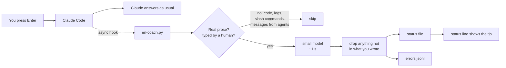

<p align="center">
  
</p>

<p align="center">
  <a href="https://github.com/Skyxu-001/en-coach/actions/workflows/test.yml"></a>
  
  
  
  <br>
  <b>English</b> · <a href="README.zh-CN.md">简体中文</a>
</p>

# en-coach

**Practise English with the prompts you already type to Claude Code. Claude never sees the lessons.**

You keep working as usual. Each message you send gets a quick look from a small,
cheap model, and a line or two of coaching appears under your prompt a second later:
the grammar you got wrong, the English for the Chinese words you couldn't think of,
or a more natural way to say what you just said.

<p align="center">
  
  <br><sub>Real model output from the hook; the terminal frame is simplified.</sub>
</p>

## Why I built it

I'm a software engineer whose first language is Chinese. I spend all day talking
to Claude Code, half in English and half in Chinese, and that was hours of
practice I wasn't learning anything from. Flashcard apps never stuck. So I put
the lessons where I already am, and kept them out of the way:

- **Zero extra effort.** No app, no commands, no flashcards. Just keep coding.
- **Mixed Chinese and English is fine.** Write `how do I 撤销 the last commit` and
  it teaches you `撤销 → undo / revert / roll back`. Writing in whatever comes
  out first is the point, not a compromise.
- **Claude is unaffected.** The hook prints nothing; tips go to the status line,
  which is not part of the conversation. Claude's answers are the same with or
  without it (checked by running the same prompts both ways).
- **Cheap, and not tied to one provider.** About **$0.10 a month** at ~40 coached
  messages a day with DeepSeek. Also tested with OpenAI, Gemini, Claude, Qwen,
  Kimi and GLM, or run a local model ([tested models](#tested-models)).

## What it teaches

| | When | What you see |
|---|---|---|
| **FIX** | you wrote English | the error, quoted in context, and the fix: `is failling → is failing` |
| **GAP** | you mixed in Chinese | the English for the part you didn't know: `撤销 → undo / revert / roll back` |
| **SAY** | you wrote Chinese | just one or two phrases worth learning: `联调 → integration testing` |
| **REWRITE** ↻ | grammatical but sounds translated | how a native engineer would say it |

**Green** is what you wrote, **red** is what to learn. Everything is also saved to
`~/.claude/english/errors.jsonl`, your personal log of mistakes to review later.

## Install

You need Python 3.9+ and an API key for an OpenAI-compatible chat API
(DeepSeek by default; [other providers](#tested-models) work too).

**As a Claude Code plugin** (recommended). In a terminal:

```sh
claude plugin install en-coach --marketplace Skyxu-001/en-coach
```

then, inside Claude Code, run this once:

```
/en-coach:setup
```

The plugin brings the hook. `/en-coach:setup` sets the status line, which a
plugin can't do by itself; run it again after updating the plugin. On Claude
Code older than 2.1.275, add the marketplace first:
`claude plugin marketplace add Skyxu-001/en-coach`, then
`claude plugin install en-coach@en-coach`.

**Or without the plugin system:**

```sh
git clone https://github.com/Skyxu-001/en-coach.git
cd en-coach
python3 install.py          # Windows: py install.py
```

Use one way or the other, not both. (`/en-coach:setup` removes a hook left by
`install.py`, so switching to the plugin is safe.)

Then give it your key, in your shell profile:

```sh
export DEEPSEEK_API_KEY=sk-...
```

or in the `env` block of `~/.claude/settings.json`:

```json
{ "env": { "DEEPSEEK_API_KEY": "sk-..." } }
```

Start a new Claude Code session and type something. Either way:

- the scripts are copied to `~/.claude/english-coach/`
- one **async** `UserPromptSubmit` hook runs on each prompt, so it never slows
  your prompt down
- the status line shows the tip; **if you already have a status line it is
  kept** and shown above the tip
- `settings.json` is backed up before it is changed

`python3 install.py --dry-run` shows the change without making it.

To remove it: `/en-coach:setup remove` (or `python3 ~/.claude/english-coach/install.py --uninstall`)
puts your old status line back, then `claude plugin uninstall en-coach` if you
used the plugin. Your error log is kept.

No tip showing up? The hook fails silently on purpose, so check the setup by hand:

```sh
python3 ~/.claude/english-coach/en-coach.py --check     # Windows: py
```

It prints the endpoint, the model, whether a key was found (never the key
itself), the model's raw reply or the HTTP error, and the tips it would show.

## Configuration

All optional, set as environment variables:

| Variable | Default | |
|---|---|---|
| `EN_COACH_API_KEY` | | API key for whatever endpoint you use |
| `DEEPSEEK_API_KEY` | | used only when the endpoint is DeepSeek, so a DeepSeek key is never sent to another provider. Using another endpoint? Put its key in `EN_COACH_API_KEY` |
| `EN_COACH_BASE_URL` | `https://api.deepseek.com` | any OpenAI-compatible endpoint, e.g. `https://api.openai.com/v1`, `https://openrouter.ai/api/v1`, or a local Ollama `http://localhost:11434/v1` |
| `EN_COACH_MODEL` | `deepseek-flash` | model name for that endpoint |
| `EN_COACH_EXTRA_BODY` | | JSON merged into the request, for per-model switches such as turning thinking off; `null` removes a field. Values for each provider are in the table below |
| `EN_COACH_NATIVE_LANGUAGE` | `zh` | your first language: `zh` Chinese, or **beta** `ja` Japanese, `ko` Korean, `es` Spanish |
| `EN_COACH_LOG` | `1` | `0` to stop writing the error log |
| `EN_COACH_DATA_DIR` | `~/.claude/english` | where tips and the log live |

Pick a fast model. The tip is only useful if it shows up while you're still
looking at your prompt.

### Tested models

You don't have to use DeepSeek. Switching takes three lines, for example OpenAI:

```sh
export EN_COACH_BASE_URL=https://api.openai.com/v1
export EN_COACH_MODEL=gpt-4.1-mini
export EN_COACH_API_KEY=sk-...
```

Every row below ran the same 6 test messages (English with mistakes, mixed
Chinese and English, all Chinese) through the real hook and gave sensible tips.
Median time for the model call, measured from the US on 2026-11-09, one run each:

| Provider | `EN_COACH_BASE_URL` | `EN_COACH_MODEL` | `EN_COACH_EXTRA_BODY` | Median |
|---|---|---|---|---|
| DeepSeek (default) | `https://api.deepseek.com` | `deepseek-flash` | | 1.2 s |
| OpenAI | `https://api.openai.com/v1` | `gpt-4.1-mini` | | 1.1 s |
| OpenAI | `https://api.openai.com/v1` | `gpt-5.4-mini` | `{"max_tokens": null, "max_completion_tokens": 320, "reasoning_effort": "none"}` | 0.8 s |
| Gemini, via OpenRouter | `https://openrouter.ai/api/v1` | `google/gemini-3.8-flash` | `{"reasoning": {"effort": "low"}}` | 1.9 s |
| Gemini, via OpenRouter | `https://openrouter.ai/api/v1` | `google/gemini-3.5-flash-lite` | | 0.9 s |
| Claude, via OpenRouter | `https://openrouter.ai/api/v1` | `anthropic/claude-haiku-5.5` | `{"reasoning": {"effort": "none"}}` | 1.0 s |
| Qwen (Alibaba Cloud international) | `https://dashscope-intl.aliyuncs.com/compatible-mode/v1` | `qwen3.8-flash` | `{"enable_thinking": false}` | 1.7 s |
| Kimi (Moonshot) | `https://api.moonshot.cn/v1` | `kimi-k2.6` | `{"temperature": null, "thinking": {"type": "disabled"}}` | 2.8 s |
| GLM (Zhipu) | `https://open.bigmodel.cn/api/paas/v4` | `glm-5.3-flashx` | `{"reasoning_effort": "low"}` | 2.6 s |

Notes:

- The instructions were tuned on DeepSeek, and it is still the cheapest. Gemini
  3.8 Flash gave the most tips; Claude Haiku missed the mistakes in one English message.
- Kimi, GLM and Qwen were measured from the US; expect them to be faster from China.
  A Kimi key from platform.moonshot.cn only works on `api.moonshot.cn`.
- `EN_COACH_EXTRA_BODY` is JSON inside a string. In a shell, single-quote it:
  `export EN_COACH_EXTRA_BODY='{"reasoning_effort": "low"}'`. In the `env` block of
  `settings.json`, escape the inner quotes:
  `"EN_COACH_EXTRA_BODY": "{\"reasoning_effort\": \"low\"}"`.

**Not in the table?** Almost every failure was one of two things: the model
*thinks* before answering and spends all its tokens on that (empty reply), or it
rejects a standard field (`max_tokens`, `temperature`). Run `--check` to see which,
then switch thinking off or drop the field with `EN_COACH_EXTRA_BODY`. Avoid
reasoning-only models: one took 7.8 s and produced nothing.

**Local models (Ollama)** work too: `EN_COACH_BASE_URL=http://localhost:11434/v1`,
any model name, and any non-empty `EN_COACH_API_KEY`. Quality depends on size.
Small models (1B to 3B, what fits a 4 GB GPU) gave almost no usable tips, and
7B to 27B open models were noticeably worse than the cloud models above. Use
the biggest model your machine runs in well under the 12-second limit, and note
that the first message after Ollama loads a model is slower.

## How it works



A few things that took real debugging to get right, all covered by the 93 offline tests:

- **Only your words get coached.** Code, stack traces, logs, diffs, and command
  lines are stripped line by line. Messages that the harness injects (background
  task notices, other sessions, sub-agents) are removed too.
- **The model is not trusted.** Any correction whose quoted text isn't literally in
  your message is dropped, and so is a rewrite that only repeats a correction.
- **Nothing it prints can reach Claude.** The hook writes files, never stdout;
  a test runs the real script and checks that it prints nothing.
- **It works on Chinese Windows.** stdin is pinned to UTF-8. Without that, every
  Chinese prompt arrived as mojibake and nothing happened, with no error.

The full list of what broke and why is in [docs/lessons-learned.md](docs/lessons-learned.md),
including seven ways I tried to make the model teach *more* that all failed.

## Optional: spell-check as you type

Claude Code's built-in `spellcheck` setting uses hunspell to underline typos in
the input box, locally and for free. [`spellcheck/`](spellcheck) has a small
dictionary of tech words (`yaml`, `kubectl`, `webhook`...) so they aren't flagged.
See [spellcheck/README.md](spellcheck/README.md).

## FAQ

**Will this change Claude's answers?**
No. The hook writes nothing to stdout, and the status line is not sent to the model.

**What gets sent to the API?**
Up to 400 characters of the prose in your message, after code and logs are removed.
Nothing else: not your files, not Claude's replies. Things that look like secrets
(API keys and tokens, `password is ...`, `user:pass@` in URLs, `key = value`
assignments) are masked before sending and before logging. That is a best
effort, not a guarantee, so don't paste secrets into prompts.

**I don't speak Chinese. Is it useful?**
FIX and REWRITE work for anyone writing English. For GAP and SAY, set
`EN_COACH_NATIVE_LANGUAGE` to `ja`, `ko` or `es` (beta): mix your language into
an English sentence and it teaches the English for that part, e.g.
`the deploy está atascado` → `is stuck / is hanging`. The instructions were
tuned on Chinese, so feedback from speakers of these languages is very welcome.
Another language? The examples live in `NATIVE_LANGUAGES` in
[`hooks/en-coach.py`](hooks/en-coach.py).

**Is it slow?**
The hook runs in the background. The tip appears 1 to 6 seconds after you press
Enter: about a second for the model, plus up to 5 seconds for the status line to
refresh. Don't lower `refreshInterval` below 5; see the lessons doc for why.

## Tests

```sh
python3 -B tests/test_en_coach.py
```

Offline, no key needed. CI runs them on Linux, macOS, and Windows with Python 3.9 and 3.13.

## Acknowledgements

The async-hook-plus-status-line pattern comes from
[rapita/claude-grammar](https://github.com/rapita/claude-grammar), and the idea of
reading the transcript to tell human input from injected input comes from
[zhangrui-vibe/claude-code-english-coach](https://github.com/zhangrui-vibe/claude-code-english-coach).
Both are MIT; see [THIRD_PARTY_NOTICES.md](THIRD_PARTY_NOTICES.md).

## License

[MIT](LICENSE)
