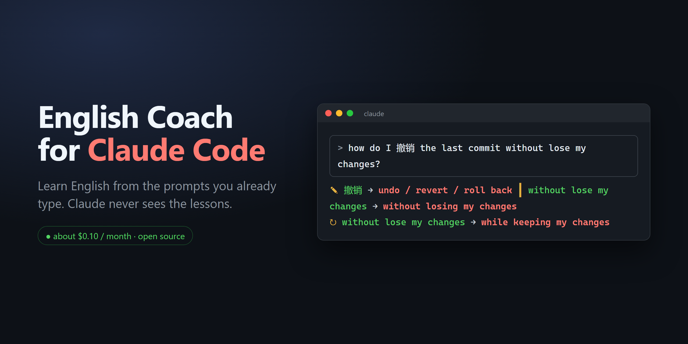
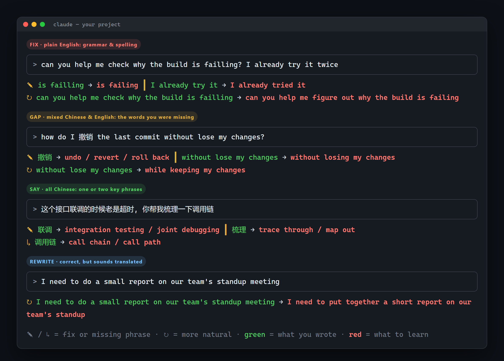

<p align="center">
  
</p>

<p align="center">
  <a href="https://github.com/Skyxu-001/en-coach/actions/workflows/test.yml"></a>
  
  
  
  <br>
  <a href="README.md">English</a> · <b>简体中文</b>
</p>

# en-coach

**你平时怎么用 Claude Code 就怎么用，每条消息顺带变成一次英语练习。Claude 完全看不到。**

你发出的每条消息，会被一个又快又便宜的小模型看一眼。大约一秒后，输入框下面出现一两行提示：
英文写错的地方、中文里不会说的那个词的英文、或者"没错，但母语者会这么说"。

<p align="center">
  
  <br><sub>提示内容是 hook 的真实模型输出，终端外框做了简化。</sub>
</p>

## 为什么做这个

我是母语中文的程序员，每天大量时间在跟 Claude Code 说话，一半中文一半英文。
这几个小时本来都可以是英语练习，但什么也没学到；背单词 App 又总坚持不下来。
所以我把练习放到每天本来就在的地方，而且不打扰工作：

- **零额外操作**：不用开 App、不用敲命令、不用背卡片，照常写代码就行。
- **中英夹杂随便写**：写 `how do I 撤销 the last commit`，它就教你 `撤销 → undo / revert / roll back`。想到什么写什么，这是设计意图，不是将就。
- **不影响 Claude**：hook 不往对话里输出任何东西，提示只显示在状态栏，状态栏不会发给模型。装不装它，Claude 的回答都一样（同样的消息两边各跑一遍对照过）。
- **便宜**：用 DeepSeek，每天约 40 条，一个月大约 **0.1 美元**。任何兼容 OpenAI 接口的模型都能用。

## 教什么

| | 什么时候 | 你会看到 |
|---|---|---|
| **FIX** 纠错 | 写的是英文 | 带上下文的错处和改法：`is failling → is failing` |
| **GAP** 补词 | 中英夹杂 | 你卡住的那部分怎么说：`撤销 → undo / revert / roll back` |
| **SAY** 学表达 | 全是中文 | 只挑一两个值得学的说法：`联调 → integration testing` |
| **REWRITE** ↻ 改写 | 语法没错但像翻译腔 | 母语工程师会怎么说 |

**绿色**是你写的，**红色**是要学的。所有提示同时存进 `~/.claude/english/errors.jsonl`，是你自己的错题本，方便以后复习。

## 安装

需要 Python 3.9+，和一个兼容 OpenAI 接口的模型 API key（默认 DeepSeek）。

```sh
git clone https://github.com/Skyxu-001/en-coach.git
cd en-coach
python3 install.py          # Windows 用 py install.py
```

然后把 key 告诉它，二选一。写进 shell 配置：

```sh
export DEEPSEEK_API_KEY=sk-...
```

或者写进 `~/.claude/settings.json` 的 `env`：

```json
{ "env": { "DEEPSEEK_API_KEY": "sk-..." } }
```

新开一个 Claude Code 会话，随便发一句话试试。安装程序会：

- 把两个脚本复制到 `~/.claude/english-coach/`
- 加一个**异步**的 `UserPromptSubmit` hook（每次发消息时在后台自动跑的脚本），不会拖慢你的消息
- 让状态栏显示提示；**你原来有状态栏的话会保留**，显示在提示上面
- 改之前先备份 `settings.json`

`python3 install.py --dry-run` 只显示会改什么，不真改。
`python3 install.py --uninstall` 全部卸掉，只留错题本。

## 配置

都是可选的环境变量：

| 变量 | 默认值 | 说明 |
|---|---|---|
| `EN_COACH_API_KEY` | | 你用的那个接口的 API key |
| `DEEPSEEK_API_KEY` | | 只在接口是 DeepSeek 时才用，免得 DeepSeek 的 key 被发给别家。用别的接口就把它的 key 放进 `EN_COACH_API_KEY` |
| `EN_COACH_BASE_URL` | `https://api.deepseek.com` | 任何兼容 OpenAI 的接口，比如 `https://api.openai.com/v1`、`https://openrouter.ai/api/v1`，或本地 Ollama `http://localhost:11434/v1` |
| `EN_COACH_MODEL` | `deepseek-flash` | 该接口上的模型名 |
| `EN_COACH_LOG` | `1` | 设成 `0` 就不记错题本 |
| `EN_COACH_DATA_DIR` | `~/.claude/english` | 提示和错题本存哪 |

选快的模型：你还盯着刚发的消息时提示就出来，才有用。

## 原理和踩过的坑

工作流程图、每个设计取舍、以及一长串"不报错、只是悄悄变差"的坑（大多有对应测试），
见英文 README 的 *How it works* 和 [docs/lessons-learned.md](docs/lessons-learned.md)。
其中包括：我试了七种办法想让模型多教几条，全部无效。

## 常见问题

**会影响 Claude 的回答吗？** 不会。hook 不往标准输出写任何东西，状态栏也不会发给模型。

**会把什么发给 API？** 你这条消息里去掉代码、日志之后的文字部分，最多 400 个字符。别的都不发：不发你的文件，也不发 Claude 的回答。看起来像密钥的内容（API key、token、`password is ...`、网址里的 `用户:密码@`、`key = value` 这类赋值、`密码是 ...`）在发送和写错题本之前都会打码。这只是尽力而为，不是保证，别往 prompt 里贴密钥。

**慢吗？** hook 在后台跑。按回车后 1 到 6 秒出提示：模型约 1 秒，状态栏最多再等 5 秒刷新。别把 `refreshInterval` 调到 5 以下，原因见 lessons 文档。

## 测试

```sh
python3 -B tests/test_en_coach.py
```

纯离线，不需要 key。CI 在 Linux、macOS、Windows 上用 Python 3.9 和 3.13 跑。

## 致谢

"异步 hook + 状态栏显示"的做法来自 [rapita/claude-grammar](https://github.com/rapita/claude-grammar)，
"读对话记录判断是不是真人输入"的思路来自 [zhangrui-vibe/claude-code-english-coach](https://github.com/zhangrui-vibe/claude-code-english-coach)。
两者都是 MIT 许可，见 [THIRD_PARTY_NOTICES.md](THIRD_PARTY_NOTICES.md)。

## 许可证

[MIT](LICENSE)
